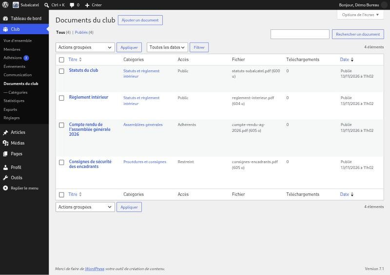
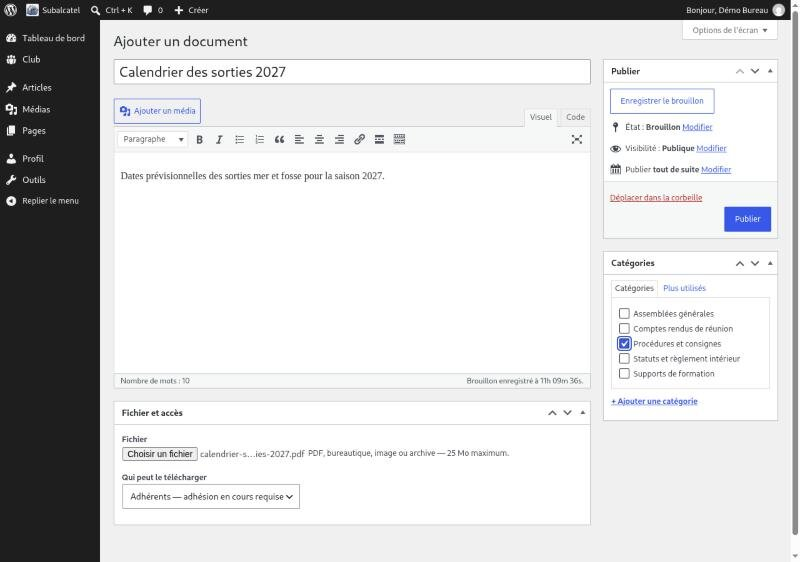
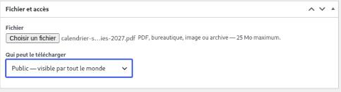
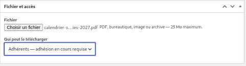
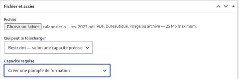
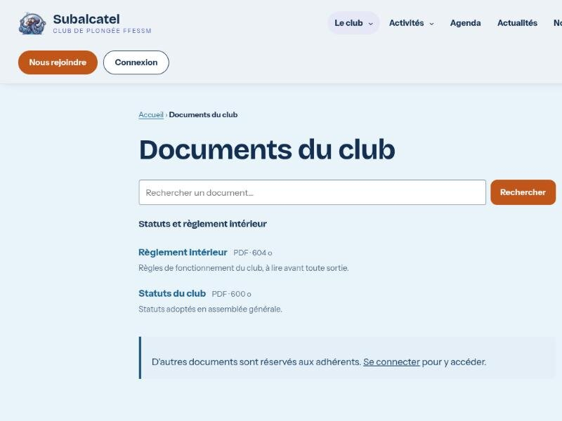
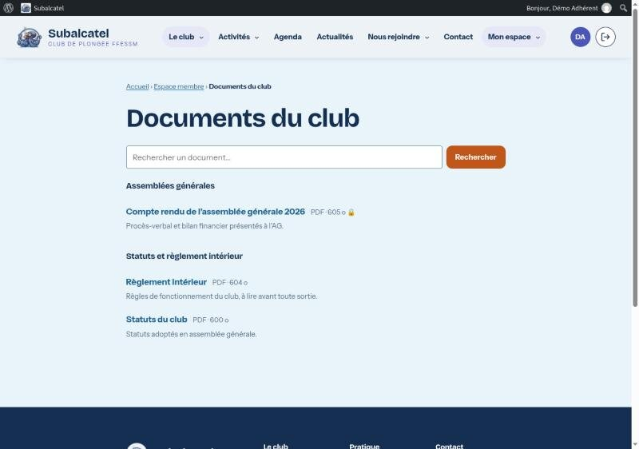
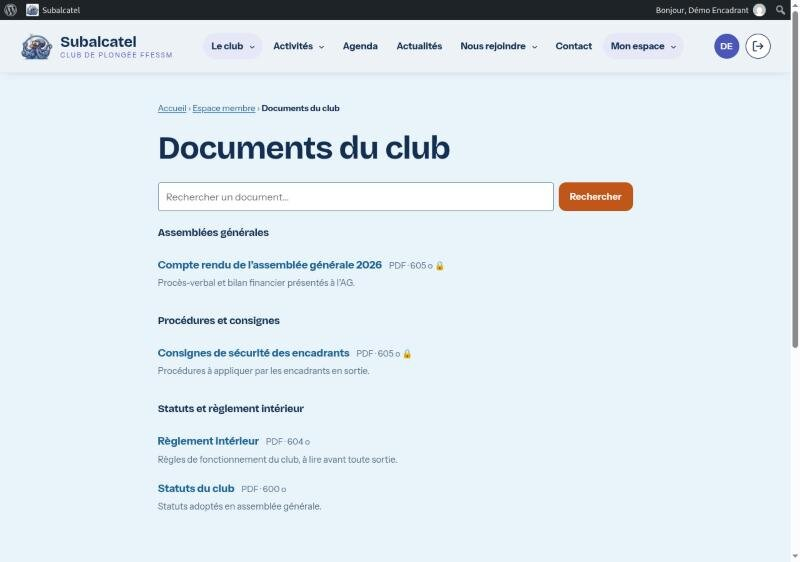
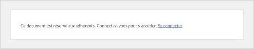
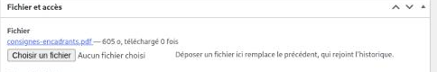

# Créer et diffuser un document du club

Guide pour le bureau : déposer un document (statuts, compte rendu d'AG,
consignes…) et choisir qui peut le télécharger. Le code de référence est
`plugins/subalcatel-club/src/Content/ClubDocuments.php`.

> Les captures viennent de la démo locale, avec des documents d'exemple.

## En bref : trois niveaux d'accès

Chaque document porte sa propre restriction. La page **Documents du club** est
ouverte à tous, mais chacun n'y voit que ce qu'il a le droit de télécharger.

| Accès choisi | Qui peut le télécharger | Exemples |
|---|---|---|
| **Public** | Tout le monde, même sans compte | Statuts, règlement intérieur, plaquette |
| **Adhérents** | Les membres connectés **dont l'adhésion est en cours** | Compte rendu d'AG, calendrier des sorties |
| **Restreint** | Les membres qui ont une capacité précise (voir plus bas) | Consignes réservées aux encadrants |

Le bureau voit et télécharge **tous** les documents, quel que soit leur accès.

## 1. Créer un document

Menu **Club → Documents du club**, puis **Ajouter un document**.

La liste montre pour chaque document son accès, le fichier attaché et le nombre
de téléchargements.

Sur l'écran d'ajout :

1. **Titre** : c'est le nom affiché aux membres (« Calendrier des sorties 2027 »).
2. **Texte** (facultatif) : une courte description, affichée sous le titre.
3. **Catégories** (à droite) : cochez la rubrique sous laquelle le document
   sera rangé. **+ Ajouter une catégorie** en crée une nouvelle.
4. **Fichier et accès** (en bas) : **Choisir un fichier**, puis **Qui peut le
   télécharger**.
5. **Publier**.

Formats acceptés : PDF, Word, Excel, PowerPoint, LibreOffice (odt, ods), JPEG,
PNG et ZIP, jusqu'à 25 Mo.

> ⚠️ **N'utilisez pas le bouton « Ajouter un média »** pour joindre le fichier.
> Il range le fichier dans la médiathèque, où il est public et n'est protégé
> par aucun accès. Seul le champ **Fichier** du cadre « Fichier et accès »
> protège le document.

> ⚠️ La ligne **Visibilité : Publique** du cadre « Publier » ne concerne pas les
> droits de téléchargement. Laissez-la telle quelle : c'est le champ **Qui peut
> le télécharger** qui décide.

## 2. Choisir qui peut le télécharger

### Document public

Choisir **Public — visible par tout le monde**. N'importe quel visiteur, même
sans compte, voit le document et le télécharge.

### Document réservé aux adhérents

Choisir **Adhérents — adhésion en cours requise**. C'est le choix proposé par
défaut.

Attention : être connecté ne suffit pas. Il faut une **adhésion en cours**
(date de fin de validité non dépassée). Ne voient donc **pas** ces documents :

- les visiteurs non connectés ;
- les comptes « Invité du club » ;
- les membres dont l'adhésion a expiré ou n'est pas encore validée.

Il n'existe pas de niveau « tout compte connecté » : un document à montrer à
quelqu'un qui n'est pas adhérent doit être public.

### Document réservé à un type de membre

Choisir **Restreint — selon une capacité précise**. Une seconde liste apparaît,
**Capacité requise** : seules les personnes qui ont cette capacité verront le
document.

La liste reprend toutes les capacités du site ; seules quelques-unes ont un
sens pour un document. Les plus utiles :

| Pour réserver le document à… | Capacité à choisir | Qui l'a |
|---|---|---|
| Encadrants et directeurs de plongée | **Créer une plongée de formation** | Tout membre dont le niveau est E1 ou plus (P2/E1, P3/E1, P4/E2, P5/E2, E3, E4) ou P5 |
| Plongeurs autonomes | **Créer une plongée d'exploration** | Tout membre de niveau P3 ou plus (y compris les encadrants à partir de P3/E1) |
| Bureau seulement | **Gérer les documents du club** | Les membres du bureau |

Les capacités liées au niveau de plongée suivent le niveau saisi sur le compte :
un membre qui passe son E1 voit aussitôt les documents réservés aux encadrants,
sans qu'il faille toucher à son compte.

À savoir : un accès **Restreint** ne vérifie pas l'adhésion. Un encadrant dont
la cotisation a expiré garde l'accès aux documents réservés aux encadrants.

## 3. Ce que voit chacun

La page **Documents du club** est dans le menu principal et dans **Mon espace**.
Les documents y sont rangés par catégorie ; un cadenas 🔒 signale un document
non public.

**Visiteur non connecté** : uniquement les documents publics, et une invitation
à se connecter.

**Adhérent à jour** : en plus, le compte rendu d'AG (accès Adhérents).

**Encadrant** : en plus, les consignes réservées aux encadrants (accès
Restreint).

## 4. Diffuser un document

- **Par la page Documents du club** : rien à faire, le document y apparaît dès
  sa publication, pour les personnes autorisées.
- **Par un lien direct** (dans un article, une actualité, un courriel) : sur
  l'écran du document, dans le cadre « Fichier et accès », faites un clic droit
  sur le nom du fichier → **Copier l'adresse du lien**. Le lien ressemble à
  `…/wp-admin/admin-post.php?action=sub_club_document&document=123`.

Le lien direct respecte l'accès du document : on peut l'envoyer à tout le club
sans risque. Une personne qui n'a pas le droit reçoit un message de refus au
lieu du fichier ; un visiteur non connecté se voit proposer de se connecter.

Les messages possibles :

- « Ce document est réservé aux adhérents. Connectez-vous pour y accéder. »
  (visiteur non connecté) ;
- « Ce document est réservé aux adhérents à jour de cotisation. » ;
- « Ce document est réservé à certains membres du club. » (accès Restreint).

Publier un document n'envoie aucun courriel. Pour prévenir les membres, publiez
une actualité avec le lien, ou écrivez-leur depuis **Club → Communication**.

## 5. Mettre à jour, retirer

- **Changer l'accès** : ouvrez le document, modifiez **Qui peut le
  télécharger**, puis **Mettre à jour**. L'effet est immédiat, y compris pour
  les liens déjà envoyés.
- **Remplacer le fichier** : choisissez un nouveau fichier puis **Mettre à
  jour**. Le lien ne change pas ; l'ancien fichier rejoint les **Versions
  précédentes**, d'où un bouton **Restaurer** le remet en place.

  

- **Masquer temporairement** : repassez le document en brouillon. Un brouillon
  n'apparaît nulle part et son lien est refusé (sauf pour le bureau).
- **Supprimer** : **Déplacer dans la corbeille**. Le fichier et toutes ses
  versions sont effacés quand la corbeille est vidée.
